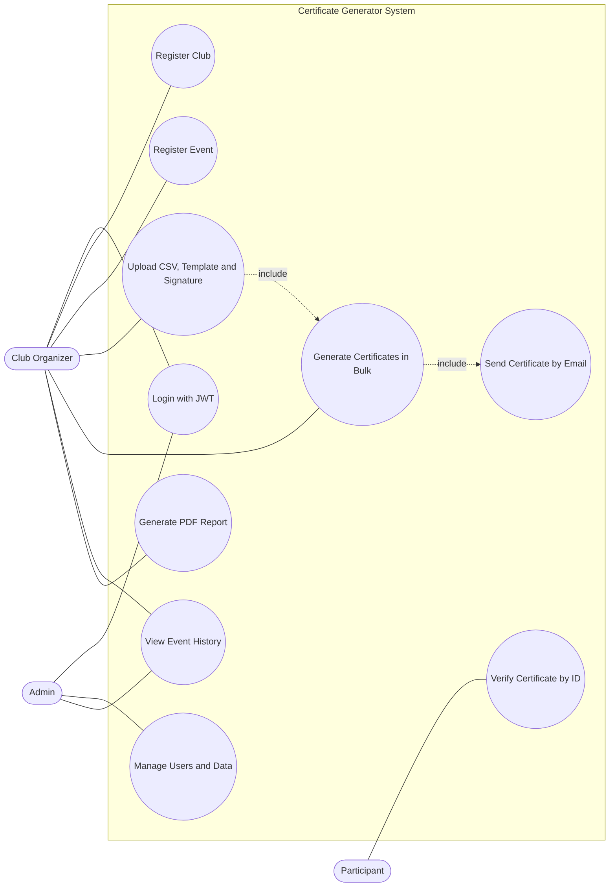
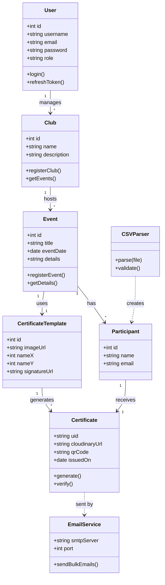
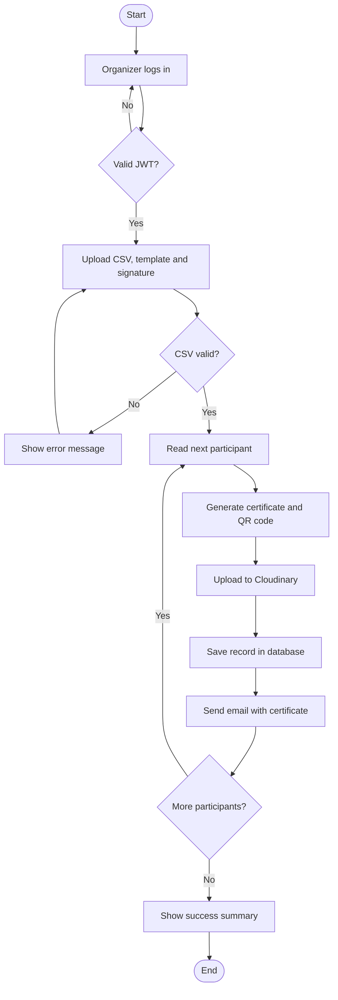
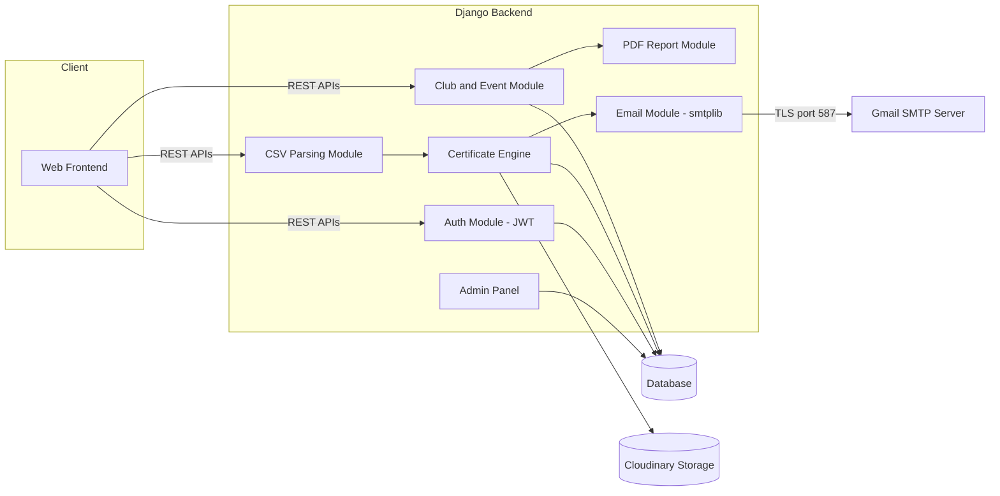

# Certificate Generator System: UML Diagrams

Project: Certificate Generator and College Club/Event Management System
Stack: Django, Django REST Framework, JWT, Cloudinary, SMTP (Gmail)

> Note: Class names and attributes below are modelled from the project description.
> Rename them to match the actual `models.py` before the viva.

---

## 1. Use Case Diagram



---

## 2. Class Diagram



---

## 3. Sequence Diagram (Bulk Certificate Generation)

```mermaid
sequenceDiagram
    actor Organizer
    participant API as Django REST API
    participant Auth as JWT Auth
    participant CSV as CSV Parser
    participant Gen as Certificate Engine
    participant Cloud as Cloudinary
    participant Mail as SMTP Email Service
    actor Participant

    Organizer->>API: POST /generate (CSV, template, signature) + JWT
    API->>Auth: Verify token
    Auth-->>API: Valid
    API->>CSV: Parse participant rows
    CSV-->>API: List of participants
    loop For each participant
        API->>Gen: Place name, QR and signature at coordinates
        Gen-->>API: Certificate image (in memory)
        API->>Cloud: Upload certificate
        Cloud-->>API: Secure URL
        API->>Mail: Send HTML email + certificate
        Mail-->>Participant: Certificate with ID and verify link
    end
    API-->>Organizer: Success response
```

---

## 4. Activity Diagram



---

## 5. Component Diagram


